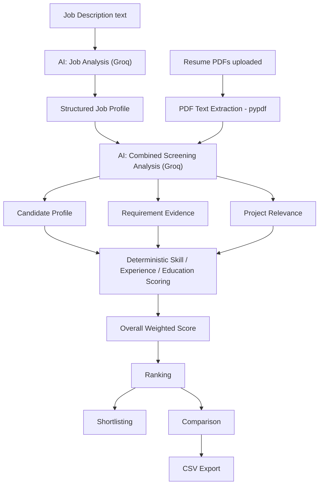
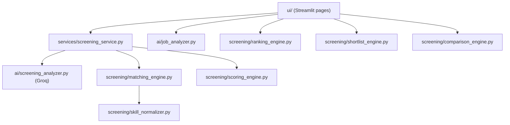

# 🎯 PreHier

### AI-Powered Pre-Hire Screening

PreHier is a Streamlit application that helps recruiters turn an unstructured hiring workflow into a structured screening pipeline. It uses an LLM (via the Groq API) to read a job description and candidate resumes, then applies deterministic Python logic to score, rank, shortlist, compare, and export candidates against that job's requirements.

[](https://www.python.org/)
[](https://streamlit.io/)
[](https://groq.com/)
[](LICENSE)
[](https://github.com/commit-msuyog/PreHier-AI/commits/main)

**Live demo:** [prehier.streamlit.app](https://prehier.streamlit.app/)

---

## Table of Contents

- [Overview](#overview)
- [Key Features](#key-features)
- [How It Works](#how-it-works)
- [AI + Deterministic Architecture](#ai--deterministic-architecture)
- [Scoring Methodology](#scoring-methodology)
- [Architecture](#architecture)
- [Project Structure](#project-structure)
- [Tech Stack](#tech-stack)
- [Getting Started](#getting-started)
- [Usage Walkthrough](#usage-walkthrough)
- [Error Handling & Reliability](#error-handling--reliability)
- [Security](#security)
- [Responsible AI & Privacy](#responsible-ai--privacy)
- [Limitations](#limitations)
- [Roadmap](#roadmap)
- [Contributing](#contributing)
- [License](#license)
- [Author](#author)

---

## Overview

### The problem

Initial resume screening is one of the most repetitive parts of hiring:

- Recruiters receive far more resumes than they can carefully read.
- Requirements from the job description get missed or under-weighted.
- Every resume presents information (skills, experience, education, projects) differently, making consistent comparison hard.
- Ranking and shortlisting a large candidate pool by hand is slow and easy to get inconsistent.

### The solution

PreHier structures that process into explicit steps: extract the job's requirements once, extract each candidate's profile from their resume, score every candidate against the same requirements using the same formula, then rank, shortlist, compare, and export the results.

**PreHier is a screening support tool, not a hiring decision engine.** It produces a score and an evidence trail to help a recruiter prioritize review — it does not decide who gets hired, and its AI-derived fields (skills, experience, evidence, project relevance) can be incomplete or wrong if the underlying resume or job description is ambiguous. Human review remains part of the process.

---

## Key Features

### 📋 Job Analysis
The recruiter pastes a job description into the **Job Setup** page. An LLM call extracts a structured job profile:

- `job_title`
- `required_skills[]`
- `preferred_skills[]`
- `experience_required` (`years`, `description`)
- `education[]`
- `responsibilities[]`

### 📄 Resume Processing
On the **Candidates** page, recruiters upload one or more resumes as **PDF files**. For each file, PreHier:

- Extracts text from every page with `pypdf`.
- Sends the resume text (together with the job profile) to the LLM, which returns a structured candidate profile: `name`, `email`, `phone`, `education[]`, `experience` (`years`, `roles[]`, `description`), `skills[]`, `projects[]`, `certifications[]`, `achievements[]`.
- Handles each resume independently, so one unreadable or scanned PDF doesn't stop the rest of the batch.

### 🎯 Skill Matching (Required & Preferred)
Candidate skills are normalized and matched against required and preferred skills separately, producing a score plus explicit matched/missing lists for each.

### 🧠 Requirement Evidence
For every required skill, the LLM is asked to judge whether the resume actually demonstrates it, returning a level (`strong` / `partial` / `none`) and a short justification.

### 📁 Project Relevance
The LLM evaluates how relevant each listed project is to the job's responsibilities and skills, again as `strong` / `partial` / `none`, with a short reason and an overall relevance verdict.

### 🧮 Deterministic Scoring
Required skills, preferred skills, experience, education, and project relevance are combined into a single weighted **Overall Score** by plain Python logic (see [Scoring Methodology](#scoring-methodology)) — not by the LLM.

### 🏆 Ranking
The **Ranking** page sorts all screened candidates by overall score, highest first, and assigns each a rank.

### ⭐ Shortlisting
From the Ranking page, recruiters can mark candidates as shortlisted; the **Shortlist** page shows only those selections.

### ⚖️ Comparison
The **Comparison** page shows every screened candidate side by side across all five scoring dimensions in a single table with progress-bar columns.

### 📥 Export
The **Export** page lets recruiters download the full comparison table — rank, all five component scores, overall score, and shortlist status — as a **CSV file**.

### 📊 Dashboard
The **Dashboard** page (the default landing page) shows total candidates screened, average match score, number shortlisted, the top candidate, and a bar chart of overall match scores across all candidates.

---

## How It Works



1. The recruiter pastes a job description and clicks **Analyze Job Description** → an LLM call returns the structured job profile.
2. The recruiter uploads one or more PDF resumes and clicks **Analyze Candidates**.
3. For each resume: text is extracted, then a single LLM call returns the candidate profile, per-skill evidence, and project relevance together.
4. Python code deterministically scores required skills, preferred skills, experience, education, and project relevance, and combines them into an overall score.
5. Results, ranking, shortlist, comparison, and CSV export are all derived from that same set of scores, held in Streamlit session state.

---

## AI + Deterministic Architecture

PreHier is not "one big AI system" — it's a deliberate split between language understanding and deterministic logic:

| Layer | Responsibility | Where |
|---|---|---|
| **AI (Groq LLM)** | Understanding unstructured text: extracting job requirements, extracting candidate profiles, judging requirement evidence, judging project relevance | `ai/job_analyzer.py`, `ai/screening_analyzer.py` |
| **Deterministic (Python)** | Skill normalization, skill matching, experience/education scoring, weighted overall score, ranking, shortlisting, comparison, export | `screening/*.py`, `services/screening_service.py` |

Why split it this way:

- The LLM is good at reading free-form text (a resume, a job posting) and pulling out structured facts and qualitative judgments.
- Once those facts exist as structured data, converting them into a score is done by plain Python — this makes the score **reproducible** (the same inputs always give the same score), **transparent** (every component is visible), and **easy to debug or re-weight** without touching the AI prompts.

**One combined AI call per resume.** Earlier in the project's history, requirement evidence and project relevance were evaluated with separate Groq calls (`screening/evidence_matcher.py` and `screening/project_matcher.py` still exist in the repository as standalone modules). The current pipeline (`ai/screening_analyzer.py`) merges candidate-profile extraction, requirement evidence, and project relevance into a **single** Groq request per resume, using `response_format: json_object` to get structured JSON back directly. This reduces the number of API calls per resume from several to one. `screening/evidence_matcher.py`, `screening/project_matcher.py`, `screening/experience_matcher.py`, and `ai/candidate_analyzer.py` remain in the codebase from that earlier design but are not currently wired into `services/screening_service.py`.

Deterministic scoring does not make the system bias-free — it removes *inconsistency* in how the arithmetic is applied, not bias that may already exist in the underlying resume, job description, or LLM output.

---

## Scoring Methodology

Each candidate's **Overall Score** is a weighted combination of five components, calculated in `screening/scoring_engine.py`:

```
Overall Score =
      Required Skills        × 0.40
    + Preferred Skills       × 0.15
    + Experience             × 0.15
    + Education              × 0.10
    + Project Relevance      × 0.20
```

| Component | Weight | What it measures |
|---|---|---|
| Required Skills | 40% | % of the job's required skills found in the candidate's skills (after normalization) |
| Preferred Skills | 15% | % of the job's preferred skills found in the candidate's skills |
| Experience | 15% | Candidate's years of experience relative to the years required |
| Education | 10% | Candidate's highest degree level relative to the required degree level |
| Project Relevance | 20% | Overall relevance of the candidate's projects to the job, as judged by the LLM |

All component scores and the overall score are on a **0–100 scale**, rounded to two decimal places.

**How missing information is handled:**
- No required skills → required-skill score is `0` (there is nothing to award).
- No preferred skills specified → preferred-skill score defaults to `100`.
- No minimum experience specified (`years <= 0`) → experience score is `100`.
- No education requirement specified → education score is `100`.
- No projects, or no relevance verdict → project relevance defaults to `none` → score `0`.

### Skill Matching

`screening/skill_normalizer.py` lowercases and trims every skill, then maps common abbreviations to a canonical form before comparing:

| Alias | Canonical form |
|---|---|
| ml | machine learning |
| ai | artificial intelligence |
| nlp | natural language processing |
| cv | computer vision |
| sklearn | scikit-learn |


`screening/matching_engine.py` then intersects the normalized required/preferred skill sets with the candidate's normalized skill set to compute matched skills, missing skills, and a percentage score. This is **exact/alias-based string matching**, not semantic or embedding-based matching — a skill described in different words than the alias list or job description will not be recognized as a match.

### Requirement Evidence

For every required skill, the combined screening call classifies evidence found in the resume as:

- **Strong** — clearly demonstrated through skills, projects, experience, or achievements.
- **Partial** — related evidence exists, but the requirement isn't clearly demonstrated.
- **None** — no meaningful evidence found.

Each classification includes a short (prompted to be under 12 words) justification, and the LLM is instructed to base evidence only on the resume content.

### Project Relevance

Each candidate project is classified against the job's responsibilities and skills as **Strong**, **Partial**, or **None**, with a short reason. The candidate's `overall_relevance` verdict is then converted into a numeric score by `relevance_to_score()`:

| Relevance | Score |
|---|---|
| Strong | 100 |
| Partial | 50 |
| None | 0 |

The prompt explicitly instructs the model to judge relevance from the work actually described, not by requiring every listed technology to appear verbatim in the job description.

### Experience Scoring

```python
if required_years <= 0:
    score = 100
elif candidate_years >= required_years:
    score = 100
else:
    score = (candidate_years / required_years) * 100
```

If no minimum is specified, or the candidate meets/exceeds it, the score is 100; otherwise it scales proportionally.

### Education Scoring

Required and candidate education strings are matched against a small set of degree-level keywords:

| Keywords | Level |
|---|---|
| phd, doctorate | 4 |
| master, m.tech, mca | 3 |
| bachelor, b.tech, b.e, bca | 2 |
| diploma | 1 |

If the candidate's highest matched level meets or exceeds the required level, the score is 100. If both sides matched a keyword but the candidate's level is lower, the score is the ratio of the two levels. If neither side's education text matches a known keyword, the score is 0. If no education requirement was extracted, the score defaults to 100.

---

## Architecture



- **`ui/`** — Streamlit pages and shared UI components (chips, badges, cards, empty states). `ui/state.py` centralizes all `st.session_state` keys (job profile, candidate profiles, match results, shortlist selections, per-resume errors) so data survives navigation across pages in Streamlit's multipage app model.
- **`services/`** — `screening_service.py` orchestrates a single resume's screening: extracting PDF text, calling the AI screening analyzer, then calling the deterministic scoring functions and assembling the final result dict.
- **`ai/`** — Groq-backed prompt functions. `job_analyzer.py` extracts the job profile; `screening_analyzer.py` performs the combined candidate-profile + evidence + project-relevance analysis; `groq_helper.py` wraps the Groq client and turns SDK errors into a single `GroqRequestError`.
- **`screening/`** — deterministic matching, scoring, ranking, shortlisting, and comparison logic (no network calls).
- **`assets/`** — static assets (currently the app logo used as the page icon).

---

## Project Structure

```
PreHier-AI/
├── ai/
│   ├── __init__.py
│   ├── groq_helper.py          # Groq client wrapper + GroqRequestError
│   ├── job_analyzer.py         # AI: job description → structured job profile
│   ├── screening_analyzer.py   # AI: resume + job profile → candidate profile, evidence, project relevance
│   └── candidate_analyzer.py   # standalone resume→profile extractor (not called by the active pipeline)
├── assets/
│   └── prehier-logo.png        # app icon (page_icon)
├── screening/
│   ├── __init__.py
│   ├── skill_normalizer.py     # skill alias normalization
│   ├── matching_engine.py      # required/preferred skill matching (used)
│   ├── scoring_engine.py       # experience/education/overall score, relevance→score (used)
│   ├── ranking_engine.py       # sorts candidates by overall score
│   ├── shortlist_engine.py     # filters ranked candidates by selection
│   ├── comparison_engine.py    # builds the side-by-side comparison rows
│   ├── evidence_matcher.py     # separate AI evidence call (not wired into the active pipeline)
│   ├── project_matcher.py      # separate AI project-relevance call (not wired into the active pipeline)
│   └── experience_matcher.py   # duplicate experience-score function (not wired into the active pipeline)
├── services/
│   └── screening_service.py    # orchestrates PDF extraction + AI call + deterministic scoring
├── ui/
│   ├── state.py                 # session_state defaults and helpers
│   ├── styles.py                 # injected CSS / design tokens
│   ├── components.py            # chips, badges, cards, empty states, score rows
│   ├── sidebar.py                # brand header, status toggles, developer credit
│   ├── job_section.py            # Job Setup page
│   ├── resume_section.py         # Candidates (upload + analyze) page
│   ├── results_section.py        # Screening Results page
│   ├── ranking_section.py        # Ranking page
│   ├── shortlist_section.py      # Shortlist page
│   ├── comparison_section.py     # Comparison page
│   ├── export_section.py         # Export (CSV) page
│   └── dashboard.py               # Dashboard page (default)
├── prehier.py                    # Streamlit entry point / page registration
├── requirements.txt
├── LICENSE
└── .gitignore
```

---

## Tech Stack

| Technology | Purpose |
|---|---|
| **Python** | Core application language |
| **Streamlit** (`1.61.1`) | Multipage web UI (`st.Page` / `st.navigation`), session state, charts, dataframes |
| **Groq API** (`groq` SDK `1.6.0`) | LLM inference — model `openai/gpt-oss-20b`, called with `response_format: json_object` |
| **pypdf** (`6.16.1`) | Extracting text from uploaded PDF resumes |
| **pandas** (`3.0.5`) | Building the comparison/export tables and the dashboard chart data |
| **python-dotenv** (`1.2.3`) | Loading `GROQ_API_KEY` from a local `.env` file |

Exact pinned versions for every dependency (including Streamlit's own transitive dependencies such as `altair`, `pyarrow`, and `pydeck`) are in [`requirements.txt`](requirements.txt).

---

## Getting Started

### Prerequisites

- Python 3.10 or newer (recommended)
- A [Groq API key](https://console.groq.com/)

### Installation

```bash
git clone https://github.com/commit-msuyog/PreHier-AI.git
cd PreHier-AI

python -m venv .venv
```

Activate the virtual environment:

```bash
# Windows
.venv\Scripts\activate

# Linux / macOS
source .venv/bin/activate
```

Install dependencies:

```bash
pip install -r requirements.txt
```

### Configuration

Create a `.env` file in the project root:

```env
GROQ_API_KEY=your_groq_api_key
```

`.env` is already listed in `.gitignore` — never commit your actual key. `ai/groq_helper.py` loads this variable at import time via `python-dotenv`.

### Running Locally

```bash
streamlit run prehier.py
```

Streamlit will open the app in your browser (default: `http://localhost:8501`).

---

## Usage Walkthrough

1. **Job Setup** — paste a job description and click **Analyze Job Description** to extract the structured job profile.
2. **Candidates** — upload one or more PDF resumes and click **Analyze Candidates**.
3. **Screening Results** — review each candidate's overall score, per-component scores, matched/missing skills, requirement evidence, and project relevance.
4. **Ranking** — see candidates ordered by overall score; shortlist directly from this page.
5. **Shortlist** — review the candidates you've selected.
6. **Comparison** — compare all screened candidates side by side across every scoring dimension.
7. **Export** — download the full results table as a CSV file.
8. **Dashboard** — check total candidates, average score, shortlist count, top candidate, and the score distribution chart at any time.

---

## Error Handling & Reliability

- **Groq API failures** (auth, network, rate limits) are caught in `ai/groq_helper.py` and re-raised as a single `GroqRequestError` with a recruiter-facing message, instead of letting the raw SDK exception propagate.
- **Malformed AI JSON** — `json_object` response formatting is used to keep Groq's output valid JSON; `ai/screening_analyzer.py` additionally strips ` ```json ` / ` ``` ` code fences defensively before parsing, and any `json.JSONDecodeError` is caught and returned as an `{"error": ..., "raw_response": ...}` dict rather than crashing the page.
- **PDF extraction failures** — `services/screening_service.py` raises a clear `ValueError` if a PDF can't be opened, or if no extractable text is found (e.g. a scanned, image-only PDF with no text layer).
- **Per-resume isolation** — in `ui/resume_section.py`, each resume is analyzed inside its own `try/except`; a failure on one resume is recorded in `screening_errors` and shown in an expandable panel, while the rest of the batch continues to process normally.
- **Defensive defaults** — `screening_service.screen_resume` falls back to empty dicts/lists for any missing field in the AI response so a partially-shaped JSON payload doesn't raise a `KeyError` deeper in scoring.

---

## Security

- Never commit your Groq API key. Keep it in `.env` (already `.gitignore`d) locally, or in your deployment platform's secret manager.
- Rotate your API key if it is ever exposed.
- Resume files may contain sensitive personal information (name, contact details, work history). Handle uploaded files and any exported CSVs accordingly, and avoid storing them anywhere beyond what your process requires.
- This project has no built-in authentication layer — if you deploy it publicly, anyone with the URL can use it and consume your Groq API quota.

---

## Responsible AI & Privacy

- Job and resume analysis is performed by an LLM and can contain errors, omissions, or misinterpretations — particularly for unusually formatted resumes or ambiguous job descriptions.
- Skill, evidence, and project-relevance matching can produce false positives (crediting something not actually present) or false negatives (missing something that is present).
- The overall score is a **decision-support signal**, not an objective measure of a candidate's ability or fit. It should not be used as the sole basis for a hiring decision.
- Candidate data (names, contact details, work history) extracted by this tool should be handled with the same care as any other personal data in your hiring process.

---

## Limitations

PreHier currently has the following limitations:

- PDF resumes only; DOCX, TXT, and other formats are not currently supported.
- Scanned or image-only PDFs are not supported because OCR is not currently implemented.
- Skill matching primarily relies on normalized skill names and predefined aliases rather than fully semantic matching.
- Candidate and job data are currently maintained in Streamlit session state rather than persistent storage.
- Authentication and multi-user isolation are not currently implemented.
- A dedicated automated test suite is not currently included.

---

## Roadmap

The following are potential future directions and are **not implemented today**:

- OCR support for scanned resumes
- Additional resume formats such as DOCX
- Automated resume ingestion instead of manual upload
- Semantic skill matching beyond predefined aliases
- User-configurable scoring weights
- Persistent database-backed storage
- Authentication and multi-user isolation
- Candidate history and audit logging
- Duplicate candidate detection across multiple resume submissions
- Automated email notifications to shortlisted candidates
- Automated interview invitation and reminder emails
- Interview scheduling based on recruiter-preferred time slots
- Google Calendar / Microsoft Outlook integration
- Richer analytics and historical dashboard insights
- Automated test suite
- Background/asynchronous resume processing
- Improved scalability for larger candidate batches

---

## Contributing

1. Fork the repository.
2. Create a feature branch: `git checkout -b feature/your-feature`.
3. Make your changes.
4. Test the app locally with `streamlit run prehier.py`.
5. Commit your changes with a clear message.
6. Push the branch and open a pull request.

---

## License

This project is licensed under the [MIT License](LICENSE).

---

## Author

**Built by Suyog Verma**
GitHub: [@commit-msuyog](https://github.com/commit-msuyog)